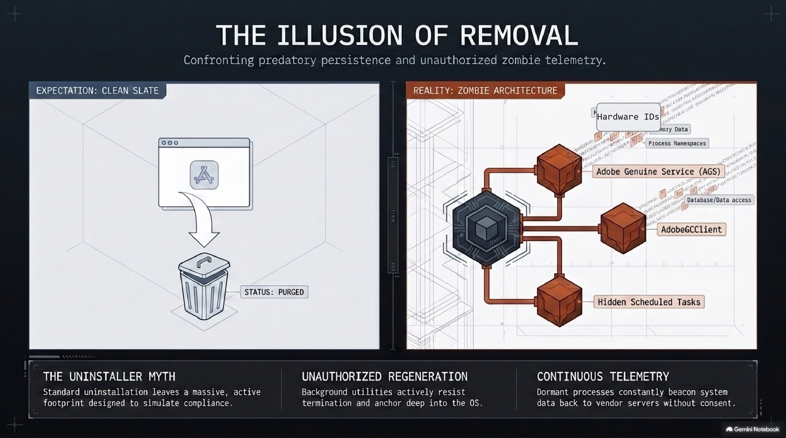
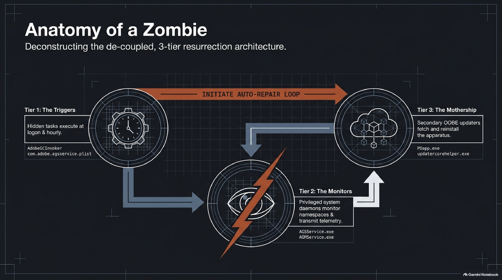
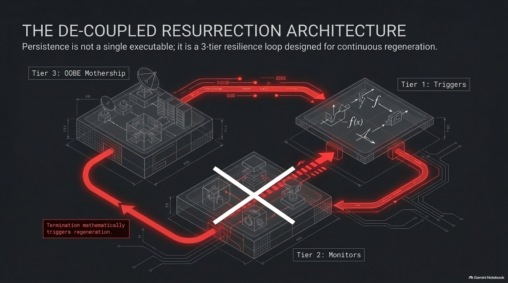
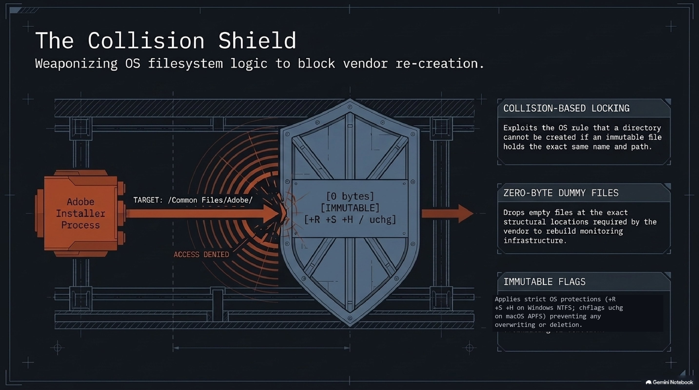
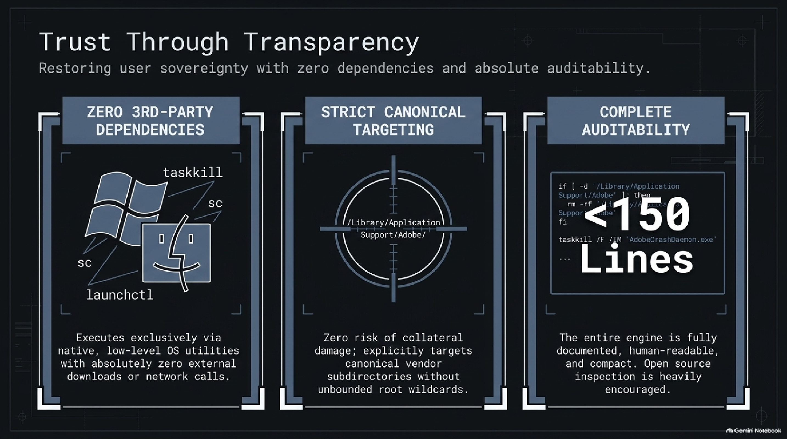

# NukeAdobe 🚀

> **Total nuclear uninstaller, background persistence cleaner, and immunization tool for Windows & macOS.**

Permanently eradicates Adobe creative applications, orphaned background services, telemetry brokers (`LogTransport2`, `AdobeIPCBroker`), updater daemons (`OOBE\PDApp`, `ARM`), LaunchDaemons, Task Scheduler hooks, and residual user caches—and installs **Immunization Shields** to prevent them from ever resurrecting.

---

```
============================================================================
         _   _ _   _ _  _______     _    ____   ___  ____  _____ 
        | \ | | | | | |/ / ____|   / \  |  _ \ / _ \| __ )| ____|
        |  \| | | | | ' /|  _|    / _ \ | | | | | | |  _ \|  _|  
        | |\  | |_| | . \| |___  / ___ \| |_| | |_| | |_) | |___ 
        |_| \_|\___/|_|\_\_____|/_/   \_\____/ \___/|____/|_____|

            TOTAL NUCLEAR ADOBE PERSISTENCE CLEANER & IMMUNIZER
============================================================================
```

---

## ⚠️ CRITICAL WARNING: THIS IS A TOTAL SYSTEM PURGE

> [!WARNING]
> **This tool is NOT a gentle selective uninstaller. It is a full-scale nuclear eradication.**
> 
> If you run NukeAdobe, it will permanently delete:
> - **All installed Adobe creative apps** (Photoshop, Premiere Pro, Illustrator, After Effects, InDesign, Acrobat, Lightroom, etc.)
> - **All background services and license monitors** (`AGMService`, `AGSService`, `AdobeUpdateService`)
> - **All Task Scheduler & LaunchDaemon persistence hooks**
> - **All user configuration, local caches, and preferences** (`%APPDATA%\Adobe`, `~/Library/Application Support/Adobe`)
> - **All Adobe Windows Registry branches** (`HKLM\Software\Adobe`, `HKCU\Software\Adobe`)
>
> **If you still rely on ANY active Adobe products on your computer, DO NOT run this tool.**

---

## Two Supported Use Cases

### 1. The "Ghost Hunter" (Post-Uninstall Persistence Cleaner)
You ran Adobe's official uninstaller or command-line removal scripts months or years ago. You assumed Adobe was gone, but discovered `AGMService.exe` quietly running in Task Manager or Activity Monitor. `NukeAdobe` hunts down and eradicates all orphaned binaries, resurrection tasks, and background services left behind.

### 2. The "Rage-Quit" (Zero-Step Clean Slate)
You have a full installation of Adobe Creative Cloud and multiple gigabytes of desktop apps, but you are completely done with their ecosystem and don't want to deal with broken uninstallers. Running `NukeAdobe` force-terminates all active applications, completely purges the program directories, wipes background services, cleans user caches, and locks the filesystem behind it.

---

## Technical Overview & Slide Deck

### Slide 1: The Illusion of Removal


### Slide 2: Anatomy of a Zombie (The 3-Tier Resurrection Loop)


### Slide 3: The NukeAdobe Protocol (6-Phase Eradication)


### Slide 4: The Collision Shield (Filesystem Locking)


### Slide 5: Trust Through Transparency (Zero Dependencies & Full Auditability)


---

## The Problem: The Adobe "Zombie" Architecture

Commercial software packages frequently fail to uninstall cleanly. Even after running standard uninstallers or command-line cleanup tools, Adobe products leave behind a multi-tiered background persistence network:

### Windows:
* **Task Scheduler:** `Adobe-Genuine-Software-Integrity-Scheduler`, `AdobeGCInvoker`
* **Background Services:** `AGMService.exe` and `AGSService.exe` (Local System privileges)
* **Autonomous OOBE Updaters:** `PDapp.exe`, `LogTransport2.exe`, `AdobeIPCBroker.exe`

### macOS:
* **LaunchDaemons & LaunchAgents:** `/Library/LaunchDaemons/com.adobe.*` and `~/Library/LaunchAgents/com.adobe.*`
* **Privileged Helpers:** `/Library/PrivilegedHelperTools/com.adobe.*`
* **Background Daemons:** `AdobeGCClient`, `Adobe Desktop Service`, `Core Sync`, `CCXProcess`

When a user deletes the app or monitor, background triggers notice the missing binary and command the updater to silently reinstall and reinstate the service.

---

## What Telemetry Is Being Sent?

When Adobe Genuine Service (`AGMService.exe`) and `LogTransport2.exe` operate in the background, they transmit encrypted telemetry bundles back to Adobe analytics endpoints:
1. **Hardware Fingerprints:** Machine UUID, MAC addresses, motherboard & CPU serials, and system hostname.
2. **System & Process Inspection:** Active process list audits, system module hashes, and integrity scans of licensing DLLs.
3. **Usage & Session Diagnostics:** Timestamps of computer activity, system wake cycles, and application error logs.

---

## The Solution: 6-Phase Eradication & Immunization

`NukeAdobe` breaks this resurrection loop completely:

1. **Process Tree Termination:** Force-kills all active and dormant Adobe executables, creative applications, IPC brokers, telemetry monitors, and crash daemons.
2. **Service & Launch Daemon Deletion:** Deregisters and wipes Windows services (`sc delete`) and macOS LaunchDaemons/LaunchAgents (`launchctl bootout`).
3. **Trigger Purging:** Wipes Windows Task Scheduler hooks and macOS plist startup agents.
4. **Directory & Payload Nuke:** Wipes all application program trees (`C:\Program Files\Adobe`, `/Applications/Adobe*`), updater folders, payload caches, and user data directories.
5. **Immunization Shields:** In both Windows NTFS and macOS HFS+/APFS, a directory cannot be created if an immutable file with the identical name already occupies that path:
   * **Windows:** Creates dummy 0-byte files marked `+R +S +H` at `AdobeGCClient` and `ARM`.
   * **macOS:** Creates an immutable file flagged with `chflags uchg` at `AdobeGCClient`.
   * Any future background installer or script that attempts to `mkdir AdobeGCClient` crashes and fails to deploy.
6. **Registry & Cache Flush:** Scrubs orphan `Uninstall` display entries and clears root `Software\Adobe` branches on Windows, or flushes DNS/mDNSResponder on macOS.

---

## Usage

### Windows
1. Download or clone this repository.
2. Right-click **`nuke_adobe.bat`**.
3. Select **"Run as administrator"**.
4. Read the warning prompt and press `Y` to confirm.

### macOS
1. Open Terminal in the repository folder.
2. Make executable and run with `sudo`:
   ```bash
   chmod +x nuke_adobe.sh
   sudo ./nuke_adobe.sh
   ```
3. Type `NUKE` when prompted to confirm.

---

## Verification

After running `NukeAdobe`, verify your system is 100% clean:

### Windows (PowerShell):
```powershell
Get-Process -Name "*Adobe*", "*AGS*", "*AGM*", "*Photoshop*", "*Premiere*"
Get-Service -Name "*AGM*", "*AGS*", "*Adobe*"
Get-ScheduledTask | Where-Object { $_.TaskName -like "*Adobe*" }
```

### macOS (Terminal):
```bash
pgrep -i adobe
launchctl list | grep -i adobe
ls -la /Library/LaunchDaemons/com.adobe.*
```

All commands return empty output.

---

## Contributing & Disclaimer

Pull requests are welcome! If you identify additional persistent binaries, telemetry endpoints, or registry keys introduced in newer Adobe software builds, feel free to submit an issue or PR.

*Disclaimer: This tool is intended for personal computing sovereignty and system cleanup. Use with full understanding that all Adobe components on the system will be permanently removed.*

## License

[MIT](LICENSE) © 2026 Adam M.
