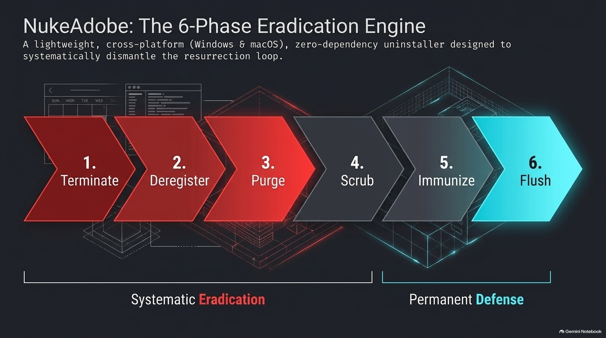
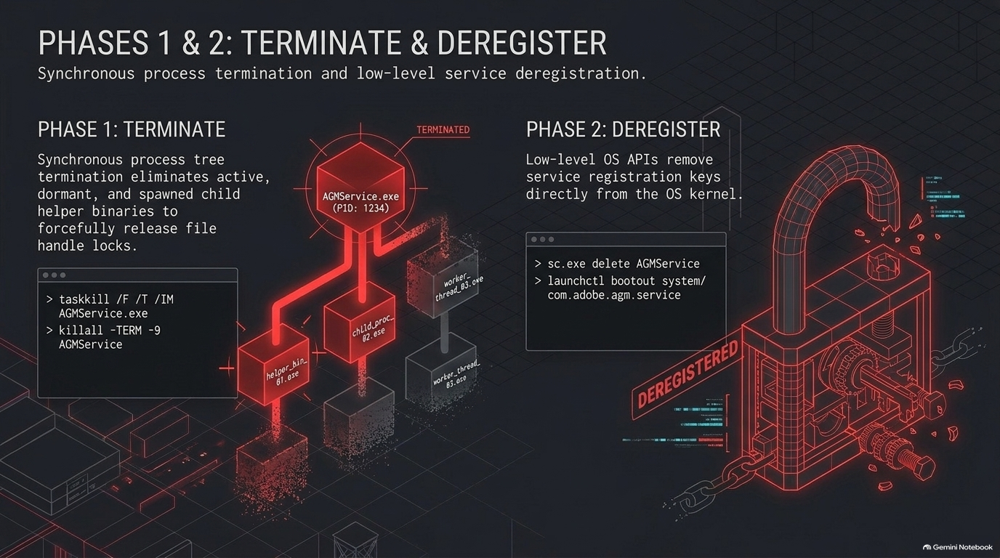
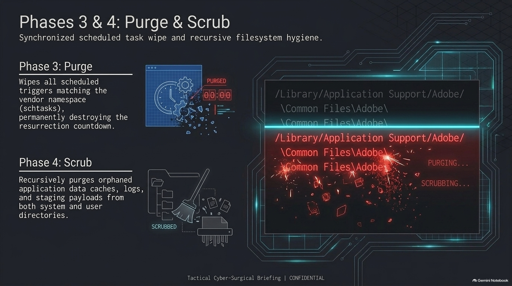
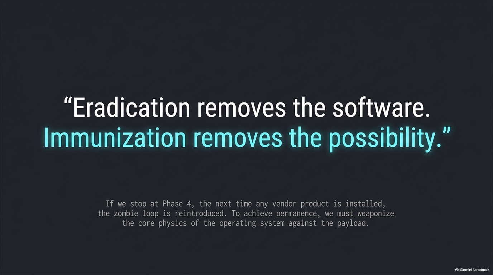
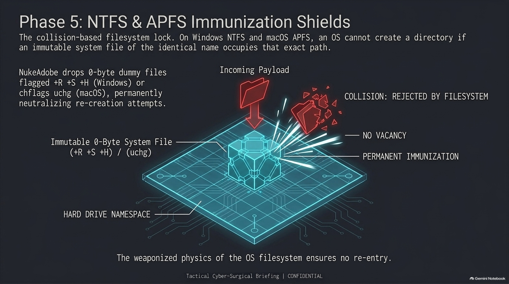
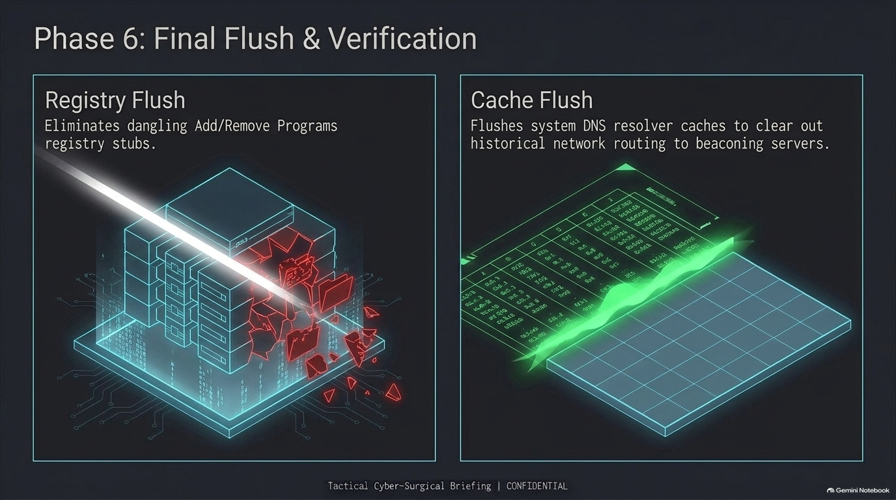
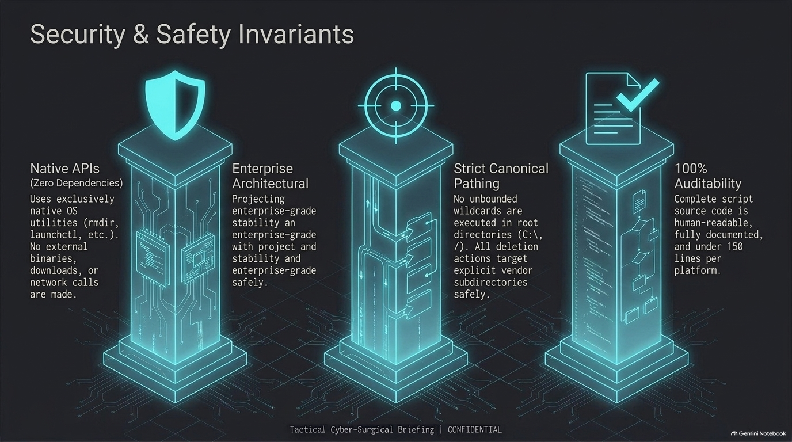
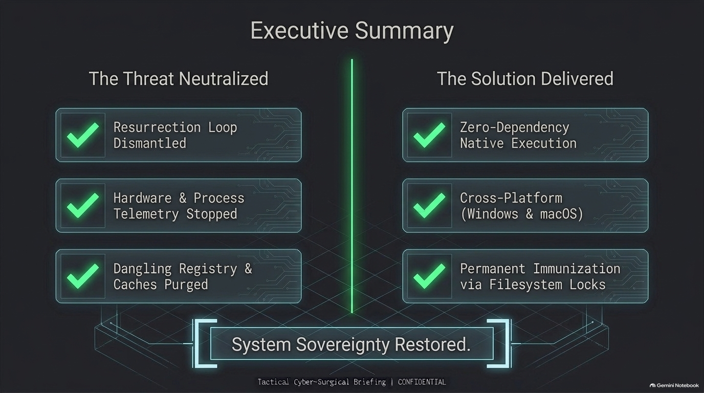

# NukeAdobe 🚀

> **Total nuclear uninstaller, background persistence cleaner, and filesystem immunization tool for Windows & macOS.**

Permanently eradicates Adobe creative applications, orphaned background services, telemetry brokers (`LogTransport2`, `AdobeIPCBroker`), updater daemons (`OOBE\PDApp`, `ARM`), LaunchDaemons, Task Scheduler hooks, and residual user caches—and installs **Immunization Shields** to prevent them from ever resurrecting.

---

### 🎙️ Quick Deep Dive: Audio & Video Explanations

Get a quick understanding of why standard uninstallers fail and how NukeAdobe completely cleans and immunizes your system:

| Media | Description | Link |
|---|---|---|
| 🎧 **Audio Deep Dive** | Concise podcast/audio walkthrough explaining how NukeAdobe permanently eradicates zombie persistence. | [Listen to Audio Overview (M4A)](docs/How_NukeAdobe_Permanently_Eradicates_Adobe_Software.m4a) |
| 🎬 **Architecture Video** | Visual presentation breakdown: *Architecting the Kill-Chain Against De-Coupled Persistence*. | [Watch Architecture Video (MP4)](docs/NukeAdobe__Architecting_the_Kill-Chain_Against_De-Coupled_Persi.mp4) |

---

```
============================================================================
         _   _ _   _ _  _______     _    ____   ___  ____  _____ 
        | \ | | | | | |/ / ____|   / \  |  _ \ / _ \| __ )| ____|
        |  \| | | | | ' /|  _|    / _ \ | | | | | | |  _ \|  _|  
        | |\  | |_| | . \| |___  / ___ \| |_| | |_| | |_) | |___ 
        |_| \_|\___/|_|\_\_____|/_/   \_\____/ \___/|____/|_____|

            TOTAL NUCLEAR ADOBE PERSISTENCE CLEANER & IMMUNIZER
============================================================================
```

---

<p align="center">
  
</p>

---

## ⚠️ CRITICAL WARNING: THIS IS A TOTAL SYSTEM PURGE

> [!WARNING]
> **This tool is NOT a gentle selective uninstaller. It is a full-scale nuclear eradication.**
> 
> If you run NukeAdobe, it will permanently delete:
> - **All installed Adobe creative apps** (Photoshop, Premiere Pro, Illustrator, After Effects, InDesign, Acrobat, Lightroom, etc.)
> - **All background services and license monitors** (`AGMService`, `AGSService`, `AdobeUpdateService`)
> - **All Task Scheduler & LaunchDaemon persistence hooks**
> - **All user configuration, local caches, and preferences** (`%APPDATA%\Adobe`, `~/Library/Application Support/Adobe`)
> - **All Adobe Windows Registry branches** (`HKLM\Software\Adobe`, `HKCU\Software\Adobe`)
>
> **If you still rely on ANY active Adobe products on your computer, DO NOT run this tool.**

---

## Two Supported Use Cases: The Illusion of Removal

<p align="center">
  
</p>

### 1. The "Ghost Hunter" (Post-Uninstall Persistence Cleaner)
You ran Adobe's official uninstaller or command-line removal scripts months or years ago. You assumed Adobe was gone, but discovered `AGMService.exe` quietly running in Task Manager or Activity Monitor. `NukeAdobe` hunts down and eradicates all orphaned binaries, resurrection tasks, and background services left behind.

### 2. The "Rage-Quit" (Zero-Step Clean Slate)
You have a full installation of Adobe Creative Cloud and multiple gigabytes of desktop apps, but you are completely done with their ecosystem and don't want to deal with broken uninstallers. Running `NukeAdobe` force-terminates all active applications, completely purges the program directories, wipes background services, cleans user caches, and locks the filesystem behind it.

---

## The Problem: The De-Coupled Resurrection Architecture

<p align="center">
  
</p>

Commercial software packages frequently fail to uninstall cleanly. Even after running standard uninstallers or command-line cleanup tools, Adobe products leave behind a multi-tiered background persistence network designed for continuous regeneration:

- **Tier 1: The Triggers** — Hidden scheduled tasks and LaunchDaemons that trigger at user logon and hourly intervals.
- **Tier 2: The Monitors** — Privileged system daemons (`AGMService.exe`, `AGSService.exe`) that continuously monitor process namespaces and open file descriptors.
- **Tier 3: The Mothership** — Autonomous OOBE updaters that notice missing binaries and deploy fresh replacement payloads to disk.

---

## Triggers & Monitors: The First Line of Persistence

<p align="center">
  
</p>

### Windows Persistence Hooks:
* **Task Scheduler:** `Adobe-Genuine-Software-Integrity-Scheduler`, `AdobeGCInvoker`
* **Background Services:** `AGMService.exe` and `AGSService.exe` (Local System privileges)
* **Autonomous OOBE Updaters:** `PDapp.exe`, `LogTransport2.exe`, `AdobeIPCBroker.exe`

### macOS Persistence Hooks:
* **LaunchDaemons & LaunchAgents:** `/Library/LaunchDaemons/com.adobe.*` and `~/Library/LaunchAgents/com.adobe.*`
* **Privileged Helpers:** `/Library/PrivilegedHelperTools/com.adobe.*`
* **Background Daemons:** `AdobeGCClient`, `Adobe Desktop Service`, `Core Sync`, `CCXProcess`

When a user deletes the app or monitor, background triggers notice the missing binary and command the updater to silently reinstall and reinstate the service.

---

## Tier 3: The OOBE Mothership & Invasive Telemetry

<p align="center">
  
</p>

Deleting the monitor binary alone does not kill the software—it simply activates the re-deployment sequence. Secondary updater utilities (`PDapp.exe`, `agcinvokerutility.exe`) drop fresh payloads back onto disk, restoring the exact state.

### What Telemetry Is Being Transmitted?
When Adobe Genuine Service (`AGMService.exe`) and `LogTransport2.exe` operate in the background, they transmit encrypted telemetry bundles back to Adobe analytics endpoints:
1. **Hardware Fingerprints:** Machine UUID, MAC addresses, motherboard & CPU serials, and system hostname.
2. **System & Process Inspection:** Active process list audits, system module hashes, and integrity scans of licensing DLLs.
3. **Usage & Session Diagnostics:** Timestamps of computer activity, system wake cycles, and application error logs.

---

## The Solution: NukeAdobe 6-Phase Eradication Protocol

<p align="center">
  
</p>

`NukeAdobe` is a lightweight, cross-platform (Windows & macOS), zero-dependency uninstaller designed to systematically dismantle the resurrection loop across six synchronized phases.

---

### Phases 1 & 2: Terminate & Deregister

<p align="center">
  
</p>

1. **Phase 1: Terminate** — Synchronous process tree termination eliminates active, dormant, and spawned child helper binaries to forcefully release file handle locks (`taskkill /F /T`, `killall -TERM -9`).
2. **Phase 2: Deregister** — Low-level OS APIs remove service registration keys directly from the OS kernel (`sc.exe delete AGMService`, `launchctl bootout system/com.adobe.agm.service`).

---

### Phases 3 & 4: Purge & Scrub

<p align="center">
  
</p>

3. **Phase 3: Purge** — Wipes all scheduled triggers matching the vendor namespace (`schtasks /Delete /TN ... /F`), permanently destroying the resurrection countdown.
4. **Phase 4: Scrub** — Recursively purges orphaned application data caches, logs, and staging payloads from both system and user directories (`C:\Program Files\Adobe`, `/Library/Application Support/Adobe/`).

---

### The Paradigm: Eradication vs. Immunization

<p align="center">
  
</p>

> *"Eradication removes the software. Immunization removes the possibility."*
> 
> If cleanup stops at Phase 4, the next time any vendor installer or updater runs, the zombie loop is reintroduced. To achieve true permanence, we must weaponize the core physics of the operating system against the payload.

---

### Phase 5: NTFS & APFS Immunization Shields

<p align="center">
  
</p>

In both Windows NTFS and macOS HFS+/APFS, an operating system cannot create a directory if an immutable system file of the identical name occupies that exact path. `NukeAdobe` exploits this fundamental filesystem collision rule:

* **Windows NTFS:** Drops 0-byte dummy files marked `+R +S +H` (Read-only, System, Hidden) at `AdobeGCClient` and `ARM`.
* **macOS APFS:** Drops immutable 0-byte files flagged with `chflags uchg` at `AdobeGCClient`.
* Any future background installer or script that attempts to `mkdir AdobeGCClient` is rejected by the filesystem with `ACCESS_DENIED`, permanently blocking re-creation.

---

### Phase 6: Final Flush & Verification

<p align="center">
  
</p>

* **Registry Flush:** Eliminates dangling `Add/Remove Programs` display keys, CLSIDs, and root `Software\Adobe` branches in `HKLM` and `HKCU`.
* **DNS Cache Flush:** Flushes system DNS resolver caches (`ipconfig /flushdns`, `killall -HUP mDNSResponder`) to eliminate historical network routing to telemetry beaconing endpoints.

---

## Security & Safety Invariants

<p align="center">
  
</p>

* **Zero 3rd-Party Dependencies:** Built 100% on native OS utilities (`taskkill`, `sc`, `schtasks`, `launchctl`, `rm`). Absolutely zero external binaries, downloads, or network calls are made.
* **Strict Canonical Pathing:** No unbounded wildcards are executed in root directories (`C:\`, `/`). All deletion actions target explicit vendor subdirectories safely.
* **100% Auditability:** Complete script source code is human-readable, fully commented, and compact (<150 lines per platform). Open inspection is strongly encouraged.

---

## Usage Guide

### Windows
1. Download or clone this repository.
2. Right-click **`nuke_adobe.bat`**.
3. Select **"Run as administrator"**.
4. Read the warning prompt and press `Y` to confirm.

### macOS
1. Open Terminal in the repository folder.
2. Make executable and run with `sudo`:
   ```bash
   chmod +x nuke_adobe.sh
   sudo ./nuke_adobe.sh
   ```
3. Type `NUKE` when prompted to confirm.

---

## Executive Summary & System Verification

<p align="center">
  
</p>

After running `NukeAdobe`, verify your system is 100% clean:

### Windows (PowerShell):
```powershell
Get-Process -Name "*Adobe*", "*AGS*", "*AGM*", "*Photoshop*", "*Premiere*"
Get-Service -Name "*AGM*", "*AGS*", "*Adobe*"
Get-ScheduledTask | Where-Object { $_.TaskName -like "*Adobe*" }
```

### macOS (Terminal):
```bash
pgrep -i adobe
launchctl list | grep -i adobe
ls -la /Library/LaunchDaemons/com.adobe.*
```

All commands return empty output. System sovereignty restored.

---

## Contributing & Disclaimer

Pull requests are welcome! If you identify additional persistent binaries, telemetry endpoints, or registry keys introduced in newer Adobe software builds, feel free to submit an issue or PR.

*Disclaimer: This tool is intended for personal computing sovereignty and system cleanup. Use with full understanding that all Adobe components on the system will be permanently removed.*

## License

[MIT](LICENSE) © 2026 Adam M.
